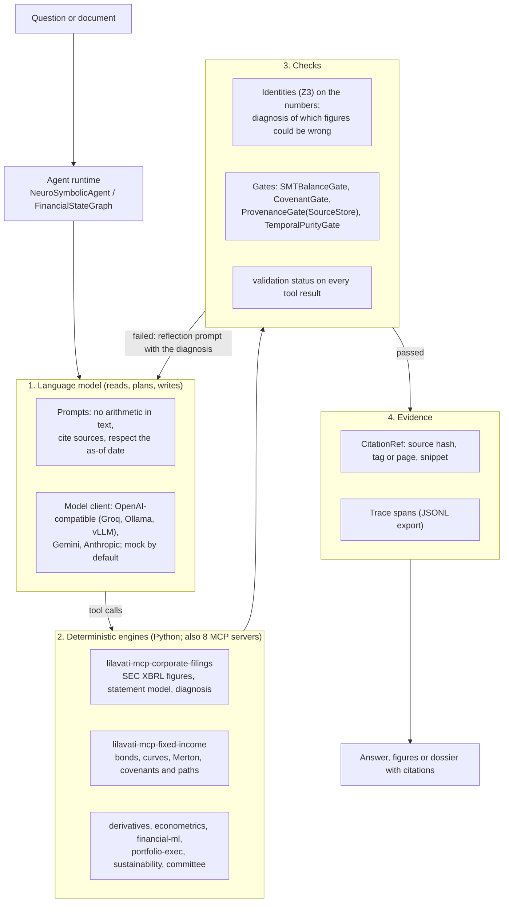

# Architecture & Runtime Specification

Līlāvatī separates what language models do (read text, plan tool calls, write prose) from what code
does (compute, check, cite). The agents built on it are described in [agents](agents.md) and the
workflows in [agent workflows](agent-workflows.md).

## 1. Prompts (`src/lilavati/prompts/`)

- `LILAVATI_CORE_SYSTEM_PROMPT`: no arithmetic in text (use tools), cite every extracted value,
  re-check the figures a diagnosis names rather than adjust numbers, respect the as-of date.
- Role prompts (`BULL_RESEARCHER_PROMPT`, `FORENSIC_BEAR_PROMPT`, `SUSTAINABILITY_ANALYST_PROMPT`,
  `PORTFOLIO_MANAGER_PROMPT`) for workflows with model roles; every tool they name is a registered MCP
  tool (`tests/test_mcp_registry.py` checks it). The library's committee does not use them: it is
  rule-based.
- `generate_smt_reflection_prompt()`: the failed identities and, given a diagnosis, the figures to
  re-check, with a warning not to pick one by plausibility when several explain the failure.

## 2. Model client (`src/lilavati/llm/`)

One client for OpenAI-compatible APIs (OpenAI, Groq presets such as `groq-gpt-oss-120b`, local Ollama
or vLLM: presets `llama3-fin-8b`, `vllm-finance-70b`), Gemini and Anthropic, with tool calling on all
three and bounded retries on 429/5xx. Keys come from environment variables. The default preset,
`mock-evaluator`, returns canned text, so examples exercise the tools rather than a model.

## 3. Runtime and checks

- `NeuroSymbolicAgent` (`runtime/`): the model requests tools; registered functions run them; tool
  rounds are capped (`completed=False` at the cap). A JSON answer is checked against every statement
  identity its figures allow; on failure the model gets the diagnosis and tries again, up to
  `max_reflection_iterations`.
- `FinancialStateGraph` (`framework/`): your node functions in sequence or by conditional edges, with
  gates between them. `ProvenanceGate(store)` resolves citations against the sources a pipeline read.
- Every MCP tool result has a `validation` field (`reference-checked`, `piloted on real data`,
  `rule-based`, `not reference-checked`), so an agent can tell a checked engine from an unchecked one.

## 4. Tracing (`src/lilavati/tracing/`)

Each run records spans for the run, each model call, each tool call (arguments, output, duration) and
each identity check (result and violations), and exports them as JSONL. Token counts and document
hashes are not recorded in the trace yet (the model client returns token usage; citations carry the
hashes).
